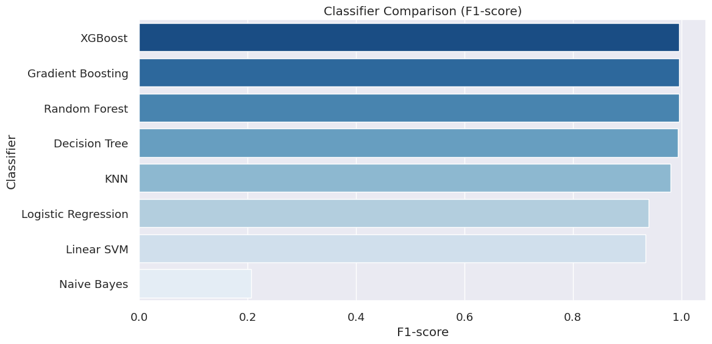
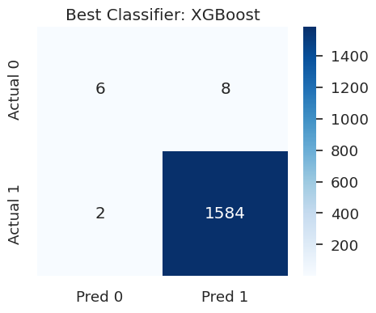

# Manufacturing Defect Analysis

**사출성형 공정 데이터로 제품 품질을 분석한 Python 머신러닝 팀 프로젝트입니다.**
KAMP 데이터를 이용해 탐색적 분석, 데이터 전처리, 불균형 처리, 분류모델 비교와 시각화를 수행했습니다.
기존 과제 노트북과 결과를 분석 흐름에 따라 정리했습니다.

| 구분 | 내용 |
|---|---|
| 문제 | 공정 센서와 제품 품질의 관계 분석 및 정상·불량 분류 |
| 데이터 | KAMP 사출성형 데이터, 기존 입력 7,996행·45열 |
| 도구 | Python, pandas, NumPy, scikit-learn, imbalanced-learn, XGBoost |
| 시각화 | Matplotlib, Seaborn |
| 프로젝트 형태 | 전자제조 데이터 분석 수업 팀 프로젝트 |

## Analysis workflow

데이터 이해·EDA → 이상치 처리·변수 변환·인코딩 → 전처리 방식 7개 비교 → 분류모델 8개 비교 → 품질 지표 해석

## Notebooks

| 순서 | 파일 | 주요 내용 |
|---|---|---|
| 1 | [Exploratory analysis](notebooks/01_exploratory_analysis.ipynb) | 데이터 구조, 분포, 장비별 차이, 품질 탐색 |
| 2 | [Data preparation](notebooks/02_data_preparation.ipynb) | 결측 구조, IQR·Z-score, 수치 변환, 범주 인코딩 |
| 3 | [Model comparison](notebooks/03_model_comparison.ipynb) | SMOTE, 층화 교차검증, 모델별 성능·혼동행렬 |

## Run

```bash
python -m venv .venv
# Windows: .venv\Scripts\activate
# macOS/Linux: source .venv/bin/activate
python -m pip install -r requirements.txt
jupyter lab
```

[데이터 준비 안내](data/README.md)에 따라 `data/labeled_data.csv`를 배치한 후 노트북을 열어 순서대로 실행하세요.
노트북은 각자 데이터를 로딩합니다. 파일을 `notebooks/`에서 실행하는 기본 Jupyter 작업 경로를 기준으로 합니다.
`requirements.txt`는 의존성 목록이며 원 실행 환경의 버전 잠금 파일은 아닙니다.

## Selected visualizations

아래 그림은 기존 과제에 저장되어 있던 결과입니다.





EDA와 전처리 전후 비교 그림도 [results/figures](results/figures/)에 포함되어 있습니다.

## Results and interpretation

기존 5-fold 교차검증에서 XGBoost가 `class=1` F1 기준으로 가장 높았습니다.
**여기서 `1=정상`, `0=불량`이므로 정상 클래스의 높은 F1을 불량 검출률로 해석하면 안 됩니다.**

| 저장된 시험 결과의 불량 기준 해석 | 값 |
|---|---:|
| 실제 불량 / 탐지 / 누락 | 14 / 6 / 8 |
| Precision | 75.0% |
| Recall | 42.9% |
| F1 | 54.5% |

수치는 저장된 혼동행렬에서 계산했습니다. 새로 모델을 학습한 결과가 아닙니다.
표·그래프의 출처는 [results](results/README.md), 전처리·검증상의 한계는 [실험 기록](docs/experiment-notes.md)에 정리했습니다.

## Portfolio evidence

- **데이터 처리 언어 활용:** pandas 데이터 탐색·집계, 이상치 처리, 변환·인코딩
- **머신러닝 개발 결과물:** 전처리·불균형 처리·교차검증·모델 비교 코드
- **데이터 시각화:** 분포, 상관관계, 공정 조건 비교, 성능 비교, 혼동행렬
