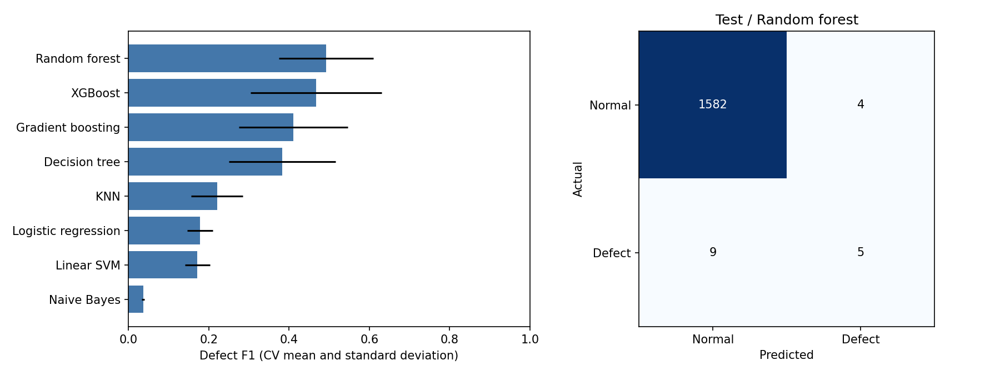
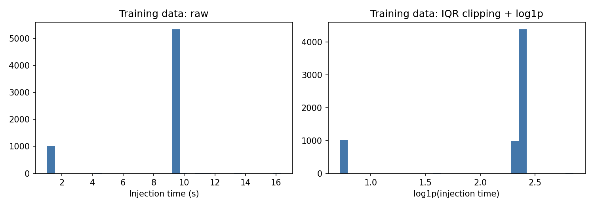

# Manufacturing Defect Analysis

사출성형 공정 데이터의 분포와 품질 차이를 살펴보고, 전처리 방법과 분류모델을 비교한 프로젝트입니다.
전자제조 데이터 분석 수업의 팀 과제를 정리했습니다.

## 데이터와 처리

[KAMP 사출성형 데이터](data/README.md)의 `labeled_data.csv`를 사용합니다. 입력은 7,996행이며 정상 7,925개, 불량 71개입니다.
**정상은 0, 불량은 1**로 두고, 모든 precision·recall·F1을 불량 기준으로 계산합니다.

검사 후 알게 되는 `Reason`과 식별자·시간 열은 예측 입력에서 뺐습니다.
학습/시험 분할 후 교차검증의 학습 fold 안에서 결측값·변환과 인코딩을 맞춥니다. IQR 경계는 제품·설비별로 계산합니다.
범주형 값을 유지한 상태에서 SMOTENC로 불균형을 조정하고, 분류 직전에 one-hot encoding을 적용합니다.

## 실행

Python 3.13.2에서 확인했습니다.

```bash
python -m venv .venv
# Windows: .venv\Scripts\activate
# macOS/Linux: source .venv/bin/activate
python -m pip install -r requirements.txt
python src/analysis.py --data data/labeled_data.csv
```

실행 결과는 `results/current/`에 저장됩니다. 노트북은 다음 순서로 볼 수 있습니다.

1. [데이터 탐색](notebooks/01_exploratory_analysis.ipynb): 분포, 결측치, 공정 변수의 상관관계
2. [데이터 전처리](notebooks/02_data_preparation.ipynb): 학습 데이터에 맞춘 clipping·변환·인코딩
3. [모델 비교](notebooks/03_model_comparison.ipynb): 전처리 7개와 분류모델 8개의 교차검증, 시험 평가

노트북 실행에는 설치한 환경의 Python 커널을 선택합니다. `--seed`와 `--folds`로 분할 조건을 바꿀 수 있습니다.

## 결과

seed 42로 80:20 층화 분할한 뒤, 학습셋에서 5-fold 교차검증의 불량 F1으로 전처리와 모델을 골랐습니다.
선택된 조합은 robust + Random forest입니다. 시험셋은 모델 선택에 사용하지 않았습니다.

| 시험셋 불량 기준 지표 | 값 |
|---|---:|
| Precision | 0.5556 |
| Recall | 0.3571 |
| F1 | 0.4348 |
| 실제 불량 / 탐지 / 누락 | 14 / 5 / 9 |





전체 정확도는 99.19%지만 불량 14개 중 9개를 놓쳤습니다. 불량 검출 성능이 충분하다고 보기 어렵습니다.
시험셋의 불량 수가 적고 같은 생산 데이터에서 무작위 분할한 결과이므로, 날짜나 설비가 다른 데이터에서도 확인할 필요가 있습니다.
수정 전 기록과 차이는 [실험 메모](docs/experiment-notes.md)에 적었습니다.
